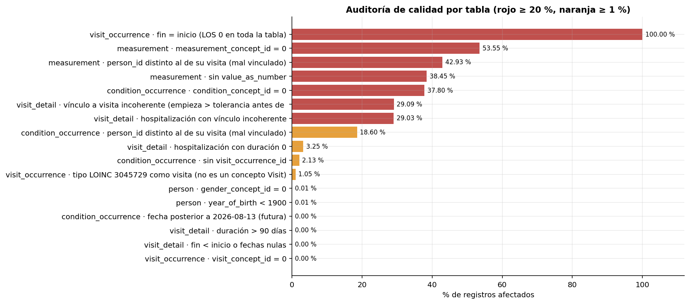
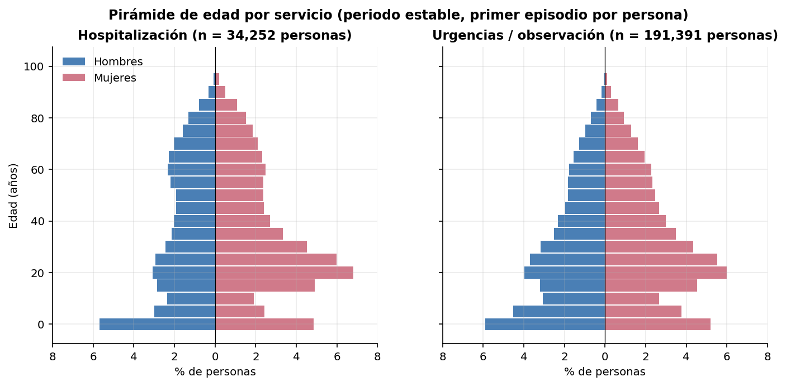
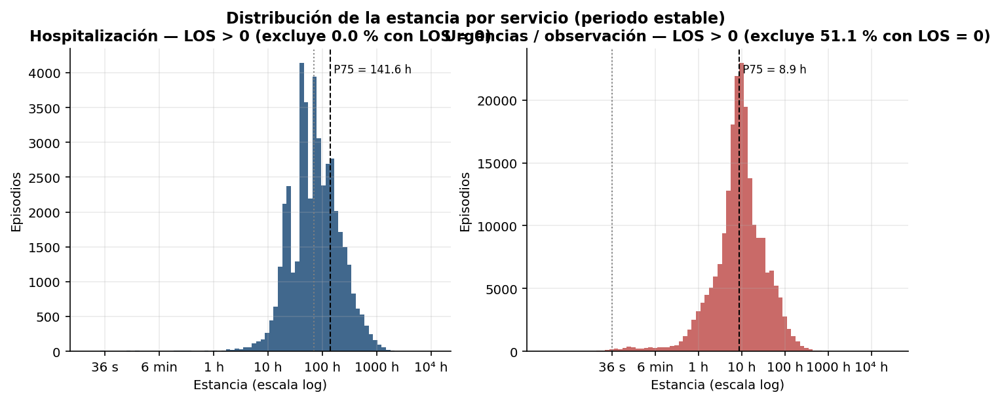
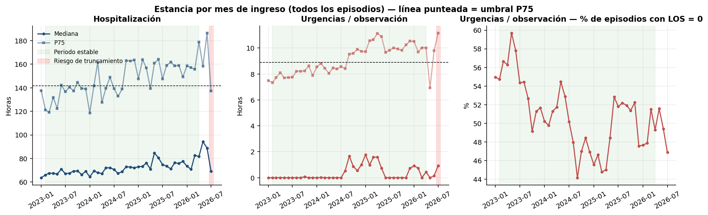
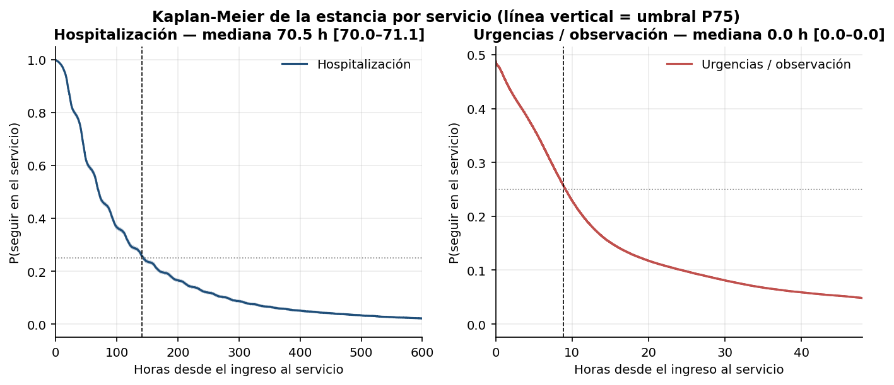
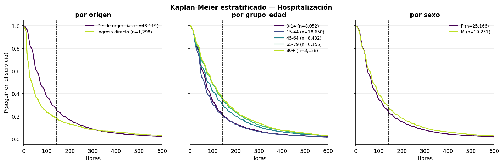
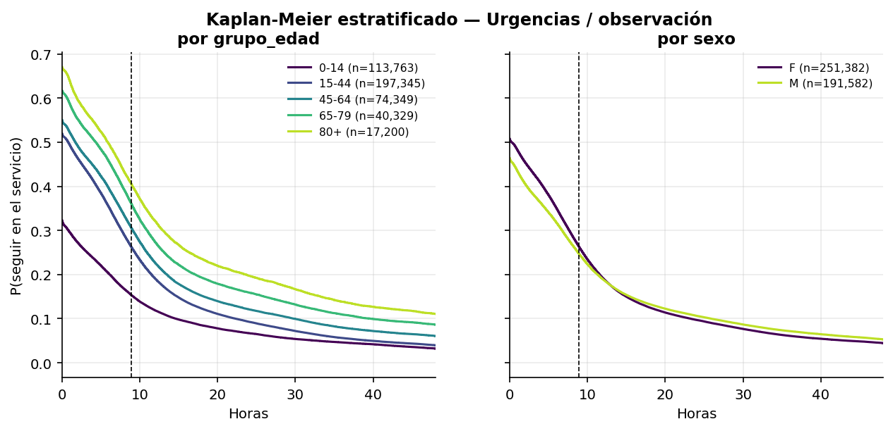
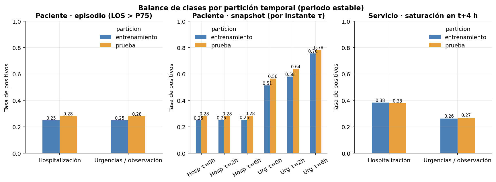
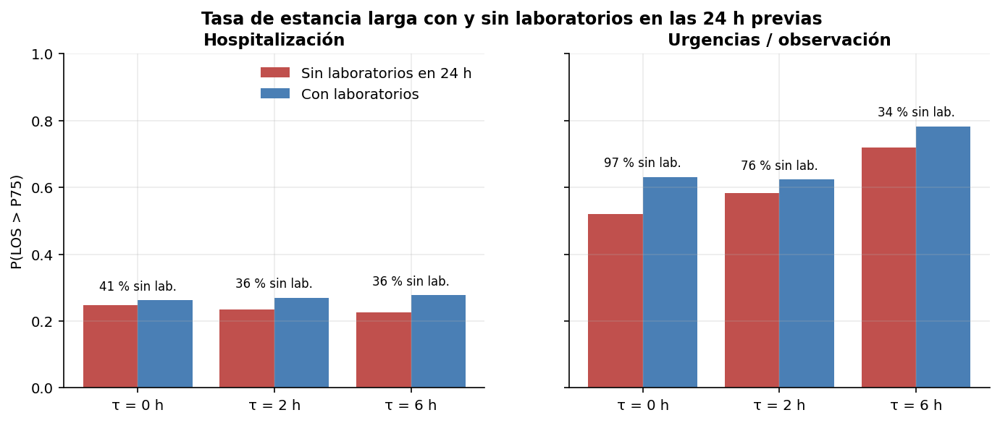
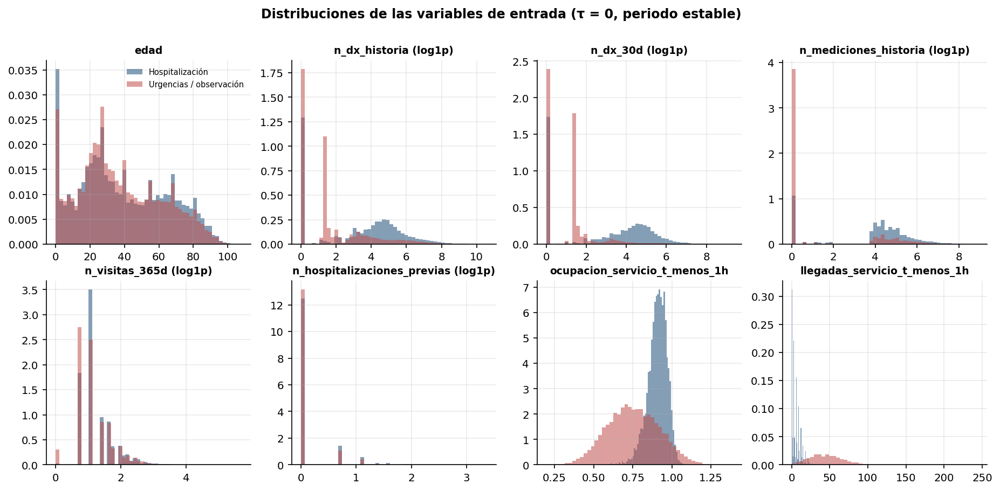

# M2 · EDA univariado, calidad y censura (HUN-201)

Persona 3 · generado por `m2_eda/run_m2.py` · datos: `data/m1/*`, `data/raw/person` · periodo estable 2023-01-31 → 2026-04-01 salvo donde se indica. Solo agregados.

**Resumen ejecutivo**

- Calidad: inconsistencias clásicas despreciables; problemas graves y ya mitigados en M1 (vínculo roto, LOS de visita = 0).
- La estancia es muy asimétrica: se resume con mediana/percentiles y curvas KM, no con la media.
- **No hay triaje**: se estratifica por servicio, origen, edad y sexo. La edad es el estratificador con más efecto.
- La censura real (estancias abiertas en la extracción) y el truncamiento afectan < 0.5 % y no tocan el periodo estable.
- La prevalencia del target de paciente en snapshots de urgencias depende de τ (0.52 → 0.76): evaluar por τ.
- **Deriva**: la estancia hospitalaria crece (mediana ~68 h en 2023 → ~75 h en 2025–26; % sobre el umbral 23 % → 28 %), así que la prevalencia en prueba es 0.28 frente a 0.25 en entrenamiento.
- **Cambio de registro en urgencias**: el % de LOS = 0 cambia por tramos dentro del periodo estable (hay que reportarlo a Persona 1).
- Hospitalización tiene un componente obstétrico/neonatal visible en la pirámide de edad.
- La falta de laboratorios no es aleatoria pero su efecto marginal es despreciable (V < 0.1): usar indicadores, no imputar.

## 1. Calidad de los datos (auditoría de inconsistencias)

Chequeos cuantificados por Persona 1 en el M1 (`reporte_calidad`), incluidos los que el plan pedía explícitamente (`visit_end < visit_start`, `year_of_birth` anómalo).

| tabla                | chequeo                                                                | n_afectados   | n_total   |      % |
|:---------------------|:-----------------------------------------------------------------------|:--------------|:----------|-------:|
| visit_occurrence     | fin = inicio (LOS 0 en toda la tabla)                                  | 1706001       | 1706001   | 100.00 |
| visit_occurrence     | visit_concept_id = 0                                                   | 2             | 1706001   |   0.00 |
| visit_occurrence     | tipo LOINC 3045729 como visita (no es un concepto Visit)               | 17858         | 1706001   |   1.05 |
| visit_detail         | fin < inicio o fechas nulas                                            | 0             | 3281613   |   0.00 |
| visit_detail         | vínculo a visita incoherente (empieza > tolerancia antes de su visita) | 954735        | 3281613   |  29.09 |
| visit_detail         | hospitalización con vínculo incoherente                                | 31524         | 108601    |  29.03 |
| visit_detail         | hospitalización con duración 0                                         | 3533          | 108601    |   3.25 |
| visit_detail         | duración > 90 días                                                     | 38            | 3281613   |   0.00 |
| condition_occurrence | person_id distinto al de su visita (mal vinculado)                     | 7186749       | 38636063  |  18.60 |
| condition_occurrence | condition_concept_id = 0                                               | 14605421      | 38636063  |  37.80 |
| condition_occurrence | sin visit_occurrence_id                                                | 823429        | 38636063  |   2.13 |
| condition_occurrence | fecha posterior a 2026-08-13 (futura)                                  | 82            | 38636063  |   0.00 |
| measurement          | person_id distinto al de su visita (mal vinculado)                     | 7115665       | 16575888  |  42.93 |
| measurement          | measurement_concept_id = 0                                             | 8876114       | 16575888  |  53.55 |
| measurement          | sin value_as_number                                                    | 6373242       | 16575888  |  38.45 |
| person               | year_of_birth < 1900                                                   | 87            | 912205    |   0.01 |
| person               | gender_concept_id = 0                                                  | 129           | 912205    |   0.01 |
| procedure_occurrence | procedure_date nulo (tabla no utilizable en el tiempo; no se extrae)   | <NA>          | <NA>      | nan    |

**Lectura.** Las inconsistencias clásicas son marginales (`visit_detail` con fin < inicio = 0; `year_of_birth < 1900` = 87 personas, 0.01 %). Los problemas graves son estructurales: la estancia en `visit_occurrence` es siempre 0 (se usa `visit_detail`), ~29 % de los subprocesos y ~19–43 % de diagnósticos/mediciones están vinculados a la visita de otra persona (se descartan con `vinculo_coherente`), y 38–54 % de conceptos son 0 (sin vocabulario).

## 2. Caracterización demográfica

**Tabla `person`** (912,205 personas): F 53.1 %, M 46.9 %, desconocido 0.01 %. Año de nacimiento fuera de [1900, 2026]: 87 personas.

**Episodios del periodo estable** (2023-01-31 → 2026-04-01):

| servicio                |   episodios |   personas |   episodios/persona | edad mediana [RIC]   |   % mujeres |   % < 15 años |   % ≥ 65 años |   % vienen de urgencias |
|:------------------------|------------:|-----------:|--------------------:|:---------------------|------------:|--------------:|--------------:|------------------------:|
| Hospitalización         |       44417 |      34252 |                 1.3 | 35 [19–61]           |        56.7 |          18.1 |          20.9 |                    97.1 |
| Urgencias / observación |      442986 |     191391 |                 2.3 | 29 [14–50]           |        56.7 |          25.7 |          13.0 |                     0.0 |

**Lectura.**

- Ambos servicios tienen un **pico en 0–4 años** y un **pico de mujeres de 15–35 años**. En hospitalización ese pico femenino es mucho más marcado que en hombres, lo que sugiere un componente **obstétrico** importante (partos/cesáreas, y recién nacidos en 0–4). No hay códigos de servicio para confirmarlo; si Persona 2 lo necesita, se puede aproximar con los diagnósticos.

- Hospitalización tiene más adultos mayores (21 % ≥ 65 frente a 13 % en urgencias) y el 97 % de sus episodios viene de urgencias.

- Sexo desconocido es despreciable (< 0.01 %).

## 3. Distribución univariada de la estancia (LOS)

| servicio                |      n |   media_h |   p10_h |   p25_h |   p50_h |   p75_h |   p90_h |   p95_h |   p99_h |   % LOS = 0 |   asimetría |   umbral P75 (train) |
|:------------------------|-------:|----------:|--------:|--------:|--------:|--------:|--------:|--------:|--------:|------------:|------------:|---------------------:|
| Hospitalización         |  44417 |    123.80 |   19.92 |   40.21 |   70.54 |  143.84 |  279.52 |  402.02 |  787.81 |        0.00 |       16.59 |               141.62 |
| Urgencias / observación | 442986 |      9.89 |    0.00 |    0.00 |    0.00 |    9.14 |   24.37 |   46.81 |  117.83 |       51.05 |      277.29 |                 8.90 |

**Lectura.** Ambas distribuciones son muy asimétricas a la derecha (asimetría 17 y 277): la media sobreestima la estancia típica y no debe usarse como resumen. En urgencias/observación el 51 % de los episodios dura 0 h (registro puntual) y la distribución es bimodal (≈ minutos vs. ≈ horas); en hospitalización la moda está en 2–4 días con cola larga de estancias de semanas.

## 4. Censura y truncamiento al final de los datos

No hay visitas abiertas (`visit_end` nunca es NULL), así que la censura clásica del plan no existe. Hay dos fenómenos reales:

1. **Estancias abiertas en la extracción** (censura por la derecha): episodios cuyo `fin` coincide con la fecha de corte (2026-07-17 18:41) ±1 h. Seguían en curso; su LOS es un mínimo.

2. **Truncamiento**: los ingresos de los últimos 30 días (`en_riesgo_truncamiento`) solo pueden aparecer si ya terminaron, así que están sesgados hacia estancias cortas.

| servicio              |   episodios |   en_riesgo_truncamiento |   abiertos_en_corte |   abiertos_en_corte_periodo_estable |   truncamiento_periodo_estable |   margen_h_hasta_corte |   % LOS > margen (prob. de truncar) |
|:----------------------|------------:|-------------------------:|--------------------:|------------------------------------:|-------------------------------:|-----------------------:|------------------------------------:|
| hospitalizacion       |       49423 |                      924 |                 176 |                                   2 |                              0 |               2586.699 |                               0.011 |
| urgencias_observacion |      493320 |                     8548 |                 290 |                                   4 |                              0 |               2586.699 |                               0.002 |

El periodo estable termina 108 días antes del corte: un ingreso del último día del periodo solo quedaría truncado si su estancia supera ese margen, cosa que ocurre en 0.011 % (hosp.) y 0.002 % (urg.) de los episodios. **Conclusión: dentro del periodo estable el sesgo por censura/truncamiento es despreciable.**

**Deriva de la estancia dentro del periodo estable** (por año de ingreso):

| servicio              |   anio |   mediana |    p75 |   pct_cero |      n |   % > umbral P75 de train |
|:----------------------|-------:|----------:|-------:|-----------:|-------:|--------------------------:|
| hospitalizacion       |   2023 |     67.81 | 136.54 |       0.00 |  12988 |                     23.14 |
| hospitalizacion       |   2024 |     69.52 | 143.62 |       0.00 |  14403 |                     25.49 |
| hospitalizacion       |   2025 |     75.06 | 157.10 |       0.01 |  13785 |                     27.64 |
| hospitalizacion       |   2026 |     73.44 | 157.60 |       0.00 |   3241 |                     28.14 |
| urgencias_observacion |   2023 |      0.00 |   7.97 |      54.56 | 137103 |                     22.77 |
| urgencias_observacion |   2024 |      0.02 |   8.92 |      49.75 | 139926 |                     25.04 |
| urgencias_observacion |   2025 |      0.29 |  10.26 |      49.29 | 135411 |                     28.56 |
| urgencias_observacion |   2026 |      0.42 |  10.11 |      49.09 |  30546 |                     27.92 |

**Lectura de la figura.**

- **Truncamiento visible al final**: en julio de 2026 la mediana y el P75 de hospitalización caen bruscamente (solo aparecen las estancias que ya terminaron). Ese mes está fuera del periodo estable.

- **La estancia crece con el tiempo**: la mediana de hospitalización pasa de ~68 h (2023) a ~75 h (2025–26) y el P75 mensual queda casi siempre **por encima del umbral fijo** de entrenamiento (141.6 h) desde 2024-07. Por eso la tasa de positivos en prueba (0.28) es mayor que en entrenamiento (0.25). Es deriva real del target, y Persona 2 debe tenerla en cuenta al calibrar (M7).

- **Cambio de registro en urgencias/observación**: el % de episodios con LOS = 0 cambia por tramos (cae entre 2024-08 y 2025-04 y otra vez desde 2025-12), y con él la mediana salta de 0 a 1–2 h. Parece un cambio en cómo se registra, no en la atención. Hay que reportarlo a Persona 1 y considerar una variable de "régimen" o validar por periodos.

**Sensibilidad de Kaplan-Meier al tratamiento de la censura** (S(umbral) = fracción que supera el P75):

| servicio                | escenario                             |      n |   censurados |   mediana_KM_h | IC95           |   S(umbral P75) |   media_simple_h |
|:------------------------|:--------------------------------------|-------:|-------------:|---------------:|:---------------|----------------:|-----------------:|
| Hospitalización         | A. Ingenuo (todos como evento)        |  49423 |            0 |         70.840 | [70.35, 71.40] |           0.260 |          124.389 |
| Hospitalización         | B. Abiertos en corte = censurados     |  49423 |          176 |         70.920 | [70.42, 71.48] |           0.260 |          124.389 |
| Hospitalización         | C. Excluir riesgo de truncamiento     |  48499 |           14 |         70.780 | [70.29, 71.32] |           0.259 |          124.534 |
| Hospitalización         | D. Solo periodo estable (recomendado) |  44417 |            2 |         70.540 | [70.01, 71.08] |           0.257 |          123.797 |
| Urgencias / observación | A. Ingenuo (todos como evento)        | 493320 |            0 |          0.000 | [0.00, 0.00]   |           0.255 |           10.037 |
| Urgencias / observación | B. Abiertos en corte = censurados     | 493320 |          290 |          0.000 | [0.00, 0.00]   |           0.255 |           10.037 |
| Urgencias / observación | C. Excluir riesgo de truncamiento     | 484772 |           22 |          0.000 | [0.00, 0.00]   |           0.255 |            9.955 |
| Urgencias / observación | D. Solo periodo estable (recomendado) | 442986 |            4 |          0.000 | [0.00, 0.00]   |           0.256 |            9.895 |

Las medianas KM y la fracción por encima del umbral apenas cambian entre escenarios: la censura afecta a < 0.5 % de los episodios. En el resto del análisis se usa el escenario D (periodo estable, abiertos en corte como censurados).

## 5. Curvas de Kaplan-Meier estratificadas (sustituto del triaje)

El plan pedía estratificar por nivel de triaje (1–5), pero **el triaje no existe** en los datos. Se estratifica por servicio, origen en urgencias (solo hospitalización: en urgencias/observación es siempre falso), grupo de edad y sexo. Evento = alta del servicio. Se reporta el log-rank (p ajustado por BH) **y** el tamaño de efecto ε² de Kruskal-Wallis sobre LOS, porque con n grande todo log-rank es significativo.

**Medianas KM por estrato** (horas, IC 95 %):

| servicio                | variable   | nivel           |      n |   mediana_h |   IC95_inf |   IC95_sup |   P(LOS > umbral) |
|:------------------------|:-----------|:----------------|-------:|------------:|-----------:|-----------:|------------------:|
| Hospitalización         | origen     | Desde urgencias |  43119 |       71.24 |      70.65 |      71.78 |              0.26 |
| Hospitalización         | origen     | Ingreso directo |   1298 |       34.29 |      29.23 |      37.76 |              0.18 |
| Hospitalización         | grupo_edad | 0-14            |   8052 |       69.42 |      68.42 |      70.55 |              0.21 |
| Hospitalización         | grupo_edad | 15-44           |  18650 |       63.15 |      61.67 |      64.16 |              0.21 |
| Hospitalización         | grupo_edad | 45-64           |   8432 |       79.48 |      75.11 |      85.41 |              0.30 |
| Hospitalización         | grupo_edad | 65-79           |   6155 |       95.04 |      92.84 |      97.53 |              0.35 |
| Hospitalización         | grupo_edad | 80+             |   3128 |       96.24 |      93.37 |     100.60 |              0.36 |
| Hospitalización         | sexo       | F               |  25166 |       68.26 |      67.59 |      68.94 |              0.24 |
| Hospitalización         | sexo       | M               |  19251 |       74.16 |      72.98 |      75.95 |              0.28 |
| Urgencias / observación | grupo_edad | 0-14            | 113763 |        0.00 |       0.00 |       0.00 |              0.15 |
| Urgencias / observación | grupo_edad | 15-44           | 197345 |        0.77 |       0.70 |       0.84 |              0.26 |
| Urgencias / observación | grupo_edad | 45-64           |  74349 |        1.69 |       1.57 |       1.82 |              0.31 |
| Urgencias / observación | grupo_edad | 65-79           |  40329 |        4.30 |       4.09 |       4.52 |              0.36 |
| Urgencias / observación | grupo_edad | 80+             |  17200 |        5.85 |       5.61 |       6.14 |              0.41 |
| Urgencias / observación | sexo       | F               | 251382 |        0.23 |       0.11 |       0.36 |              0.26 |
| Urgencias / observación | sexo       | M               | 191582 |        0.00 |       0.00 |       0.00 |              0.25 |

**Log-rank + tamaño de efecto:**

| servicio                | variable   |      n |   logrank_chi2 | p_BH    |   eps2 | magnitud ε²   |
|:------------------------|:-----------|-------:|---------------:|:--------|-------:|:--------------|
| Hospitalización         | origen     |  44417 |       109.8653 | < 0.001 | 0.0089 | despreciable  |
| Hospitalización         | grupo_edad |  44417 |       823.2520 | < 0.001 | 0.0198 | pequeño       |
| Hospitalización         | sexo       |  44417 |       103.3492 | < 0.001 | 0.0015 | despreciable  |
| Urgencias / observación | grupo_edad | 442986 |     12563.0836 | < 0.001 | 0.0450 | pequeño       |
| Urgencias / observación | sexo       | 442964 |         2.4950 | 0.114   | 0.0013 | despreciable  |

**Lectura.** Todos los log-rank son significativos (n enorme), pero el tamaño de efecto dice cuáles importan: la **edad** es el estratificador con más efecto en ambos servicios (en hospitalización, los mayores de 65 tienen curvas claramente más lentas); sexo y origen tienen efecto despreciable o pequeño. Ningún estrato por sí solo separa bien quién supera el P75: el modelo de paciente necesita variables clínicas e historial (M5).

## 6. Balance de clases de los dos targets

**Episodio:**

| servicio              | particion     |      n |   positivos |   tasa |
|:----------------------|:--------------|-------:|------------:|-------:|
| hospitalizacion       | entrenamiento |  34635 |        8658 |  0.250 |
| hospitalizacion       | prueba        |   9782 |        2742 |  0.280 |
| urgencias_observacion | entrenamiento | 350296 |       87574 |  0.250 |
| urgencias_observacion | prueba        |  92690 |       25883 |  0.279 |

**Snapshot (unidad del modelo de paciente):**

| servicio              |   horas_desde_ingreso | particion     |      n |   positivos |   tasa |
|:----------------------|----------------------:|:--------------|-------:|------------:|-------:|
| hospitalizacion       |                     0 | entrenamiento |  34634 |        8658 |  0.250 |
| hospitalizacion       |                     0 | prueba        |   9782 |        2742 |  0.280 |
| hospitalizacion       |                     2 | entrenamiento |  34496 |        8658 |  0.251 |
| hospitalizacion       |                     2 | prueba        |   9751 |        2742 |  0.281 |
| hospitalizacion       |                     6 | entrenamiento |  34274 |        8658 |  0.253 |
| hospitalizacion       |                     6 | prueba        |   9662 |        2742 |  0.284 |
| urgencias_observacion |                     0 | entrenamiento | 170960 |       87574 |  0.512 |
| urgencias_observacion |                     0 | prueba        |  45867 |       25883 |  0.564 |
| urgencias_observacion |                     2 | entrenamiento | 150972 |       87574 |  0.580 |
| urgencias_observacion |                     2 | prueba        |  40567 |       25883 |  0.638 |
| urgencias_observacion |                     6 | entrenamiento | 115924 |       87574 |  0.755 |
| urgencias_observacion |                     6 | prueba        |  33044 |       25883 |  0.783 |

**Saturación por servicio y hora:**

| servicio              |     n |   positivos |   tasa |   ocupacion_media | particion     |
|:----------------------|------:|------------:|-------:|------------------:|:--------------|
| hospitalizacion       |  6268 |    2379.000 |  0.380 |             0.932 | prueba        |
| hospitalizacion       | 19311 |    7402.000 |  0.383 |             0.927 | entrenamiento |
| urgencias_observacion |  6268 |    1690.000 |  0.270 |             0.751 | prueba        |
| urgencias_observacion | 19311 |    5082.000 |  0.263 |             0.740 | entrenamiento |

**Lectura.**

- A nivel episodio el target está en ~26 % por construcción (P75). A nivel **snapshot** la tasa **sube con τ en urgencias/observación** (≈ 0.52 → 0.59 → 0.76): los snapshots se crean solo si el paciente sigue en el servicio, así que en τ = 0 ya se excluyen los episodios de LOS 0 y en τ = 6 h solo quedan los que llevan 6 h. Persona 2 debe estratificar métricas por τ y no comparar AUC-PR entre τ sin mirar la prevalencia base.

- En hospitalización la tasa es estable entre τ (≈ 0.26) porque casi nadie sale antes de 6 h.

- La prevalencia de prueba es ~3 puntos mayor que la de entrenamiento en todos los casos del modelo de paciente (0.25 → 0.28), coherente con la estancia creciente (sección 4). En saturación no hay diferencia, porque la capacidad proxy es móvil.

- El desbalance es moderado (25–40 % positivos en casi todo): no exige sobremuestreo; basta con `class_weight` o umbral por costo (M7).

## 7. Faltantes y nulos informativos (MNAR)

**% de NULL por variable del snapshot:**

| variable                      |   Hospitalización |   Urgencias / observación |
|:------------------------------|------------------:|--------------------------:|
| n_mediciones_24h              |              0.00 |                      0.00 |
| n_mediciones_historia         |              0.00 |                      0.00 |
| n_dx_historia                 |              0.00 |                      0.00 |
| n_dx_distintos_historia       |              0.00 |                      0.00 |
| n_dx_30d                      |              0.00 |                      0.00 |
| n_visitas_365d                |              0.00 |                      0.00 |
| n_hospitalizaciones_previas   |              0.00 |                      0.00 |
| horas_desde_ultima_alta_hosp  |             83.91 |                     88.34 |
| censo_servicio_t_menos_1h     |              0.00 |                      0.00 |
| ocupacion_servicio_t_menos_1h |              0.00 |                      0.00 |
| llegadas_servicio_t_menos_1h  |              0.00 |                      0.00 |
| edad                          |              0.00 |                      0.00 |

Los NULL reales son pocos y **estructurales**: `horas_desde_ultima_alta_hosp` es NULL cuando la persona nunca estuvo hospitalizada (no es un dato perdido). El resto de variables no tiene NULL porque los conteos se construyeron con 0 por defecto. El faltante clínicamente relevante no aparece como NULL sino como **cero**: `n_mediciones_24h = 0` (no se pidió ningún laboratorio).

**Indicadores de ausencia vs target (Chi² + V de Cramér, BH):**

| servicio                |   τ_h | indicador               |   % con indicador |   tasa_target_si |   tasa_target_no |   V_cramer | p_BH    | magnitud     |
|:------------------------|------:|:------------------------|------------------:|-----------------:|-----------------:|-----------:|:--------|:-------------|
| Hospitalización         |     0 | sin_mediciones_24h      |            41.118 |            0.247 |            0.263 |      0.017 | < 0.001 | despreciable |
| Hospitalización         |     0 | sin_mediciones_historia |            18.887 |            0.252 |            0.258 |      0.001 | 0.302   | despreciable |
| Hospitalización         |     0 | sin_dx_historia         |            27.186 |            0.270 |            0.252 |      0.018 | < 0.001 | despreciable |
| Hospitalización         |     0 | nunca_hospitalizado     |            83.963 |            0.243 |            0.329 |      0.072 | < 0.001 | despreciable |
| Hospitalización         |     2 | sin_mediciones_24h      |            35.892 |            0.235 |            0.270 |      0.039 | < 0.001 | despreciable |
| Hospitalización         |     2 | sin_mediciones_historia |            13.490 |            0.229 |            0.262 |      0.026 | < 0.001 | despreciable |
| Hospitalización         |     2 | sin_dx_historia         |            26.501 |            0.265 |            0.255 |      0.009 | 0.036   | despreciable |
| Hospitalización         |     2 | nunca_hospitalizado     |            83.915 |            0.244 |            0.329 |      0.072 | < 0.001 | despreciable |
| Hospitalización         |     6 | sin_mediciones_24h      |            36.367 |            0.227 |            0.278 |      0.057 | < 0.001 | despreciable |
| Hospitalización         |     6 | sin_mediciones_historia |            11.945 |            0.212 |            0.266 |      0.039 | < 0.001 | despreciable |
| Hospitalización         |     6 | sin_dx_historia         |            26.154 |            0.269 |            0.256 |      0.013 | 0.005   | despreciable |
| Hospitalización         |     6 | nunca_hospitalizado     |            83.861 |            0.246 |            0.331 |      0.071 | < 0.001 | despreciable |
| Urgencias / observación |     0 | sin_mediciones_24h      |            96.988 |            0.520 |            0.632 |      0.038 | < 0.001 | despreciable |
| Urgencias / observación |     0 | sin_mediciones_historia |            68.514 |            0.513 |            0.545 |      0.030 | < 0.001 | despreciable |
| Urgencias / observación |     0 | sin_dx_historia         |            37.860 |            0.463 |            0.560 |      0.095 | < 0.001 | despreciable |
| Urgencias / observación |     0 | nunca_hospitalizado     |            88.503 |            0.516 |            0.580 |      0.041 | < 0.001 | despreciable |
| Urgencias / observación |     2 | sin_mediciones_24h      |            76.048 |            0.582 |            0.624 |      0.036 | < 0.001 | despreciable |
| Urgencias / observación |     2 | sin_mediciones_historia |            53.996 |            0.576 |            0.612 |      0.037 | < 0.001 | despreciable |
| Urgencias / observación |     2 | sin_dx_historia         |            32.929 |            0.539 |            0.619 |      0.077 | < 0.001 | despreciable |
| Urgencias / observación |     2 | nunca_hospitalizado     |            88.483 |            0.584 |            0.655 |      0.046 | < 0.001 | despreciable |
| Urgencias / observación |     6 | sin_mediciones_24h      |            34.368 |            0.720 |            0.783 |      0.070 | < 0.001 | despreciable |
| Urgencias / observación |     6 | sin_mediciones_historia |            25.827 |            0.716 |            0.778 |      0.064 | < 0.001 | despreciable |
| Urgencias / observación |     6 | sin_dx_historia         |            30.554 |            0.741 |            0.771 |      0.032 | < 0.001 | despreciable |
| Urgencias / observación |     6 | nunca_hospitalizado     |            87.922 |            0.756 |            0.804 |      0.037 | < 0.001 | despreciable |

**Lectura.**

- La ausencia **no es aleatoria** (todas las diferencias son significativas tras BH y tienen dirección consistente entre τ), pero su **efecto marginal es despreciable** (V de Cramér < 0.1). Por sí sola no predice la estancia larga.

- Dirección: no tener laboratorios o no tener historia se asocia con **menos** estancia larga, salvo `sin_dx_historia` en hospitalización. Que el paciente haya estado hospitalizado antes (`nunca_hospitalizado = 0`) es el indicador con más efecto (hosp.: 0.33 frente a 0.24).

- En urgencias, en τ = 0 el 97 % no tiene laboratorios, y en τ = 6 h baja al 34 %: los laboratorios se registran durante la estancia. La información MNAR crece con τ.

**Recomendación para M5.** Incluir los indicadores binarios (`sin_mediciones_24h`, `nunca_hospitalizado`, `sin_dx_historia`). Son baratos y pueden interactuar con otras variables en modelos de árboles. **No imputar** `horas_desde_ultima_alta_hosp` con la mediana: usar el indicador más un valor centinela dentro del `Pipeline`.

## 8. Resumen univariado de las variables de entrada (snapshot τ = 0)

| servicio                | variable                      |   mediana |    p25 |     p75 |      p99 |      máx |   % cero |   asimetría |
|:------------------------|:------------------------------|----------:|-------:|--------:|---------:|---------:|---------:|------------:|
| Hospitalización         | n_mediciones_24h              |      5.00 |   0.00 |   63.00 |   179.00 |   480.00 |    41.12 |        1.61 |
| Hospitalización         | n_mediciones_historia         |     78.00 |  46.00 |  157.00 |  1609.70 |  7286.00 |    18.89 |        7.59 |
| Hospitalización         | n_dx_historia                 |     51.00 |   0.00 |  156.00 |  3517.70 | 36354.00 |    27.19 |       12.99 |
| Hospitalización         | n_dx_distintos_historia       |      1.00 |   0.00 |    3.00 |    10.00 |    32.00 |    27.19 |        2.39 |
| Hospitalización         | n_dx_30d                      |     40.00 |   0.00 |  120.00 |  1079.00 | 10767.00 |    32.21 |        9.88 |
| Hospitalización         | n_visitas_365d                |      2.00 |   2.00 |    4.00 |    20.00 |   276.00 |     0.29 |       17.10 |
| Hospitalización         | n_hospitalizaciones_previas   |      0.00 |   0.00 |    0.00 |     4.00 |    28.00 |    83.96 |        8.87 |
| Hospitalización         | horas_desde_ultima_alta_hosp  |   1879.17 | 462.08 | 5808.74 | 22838.87 | 27405.53 |     0.06 |        1.81 |
| Hospitalización         | censo_servicio_t_menos_1h     |    282.00 | 264.00 |  299.00 |   330.00 |   351.00 |     0.00 |       -0.39 |
| Hospitalización         | ocupacion_servicio_t_menos_1h |      0.91 |   0.87 |    0.95 |     1.02 |     1.09 |     0.00 |       -0.70 |
| Hospitalización         | llegadas_servicio_t_menos_1h  |      3.00 |   0.00 |    9.00 |    24.00 |    42.00 |    26.18 |        1.40 |
| Hospitalización         | edad                          |     35.00 |  19.00 |   61.00 |    90.00 |   108.00 |     4.34 |        0.27 |
| Urgencias / observación | n_mediciones_24h              |      0.00 |   0.00 |    0.00 |    72.00 |   331.00 |    96.99 |        8.32 |
| Urgencias / observación | n_mediciones_historia         |      0.00 |   0.00 |   55.00 |  1092.74 |  7165.00 |    68.51 |        9.70 |
| Urgencias / observación | n_dx_historia                 |      3.00 |   0.00 |   18.00 |  2094.00 | 39338.00 |    37.86 |       20.02 |
| Urgencias / observación | n_dx_distintos_historia       |      1.00 |   0.00 |    2.00 |    10.00 |    40.00 |    37.86 |        3.24 |
| Urgencias / observación | n_dx_30d                      |      3.00 |   0.00 |    3.00 |   429.00 | 10860.00 |    44.46 |       23.39 |
| Urgencias / observación | n_visitas_365d                |      2.00 |   1.00 |    4.00 |    21.00 |   296.00 |     3.45 |       13.60 |
| Urgencias / observación | n_hospitalizaciones_previas   |      0.00 |   0.00 |    0.00 |     3.00 |    28.00 |    88.50 |       10.90 |
| Urgencias / observación | horas_desde_ultima_alta_hosp  |   2926.48 | 665.73 | 8178.50 | 23300.56 | 27815.73 |     0.00 |        1.35 |
| Urgencias / observación | censo_servicio_t_menos_1h     |    223.00 | 186.00 |  260.00 |   351.00 |   421.00 |     0.00 |        0.16 |
| Urgencias / observación | ocupacion_servicio_t_menos_1h |      0.75 |   0.64 |    0.87 |     1.13 |     1.38 |     0.00 |        0.05 |
| Urgencias / observación | llegadas_servicio_t_menos_1h  |     44.00 |  30.00 |   60.00 |   106.00 |   244.00 |     0.33 |        0.56 |
| Urgencias / observación | edad                          |     33.00 |  20.00 |   56.00 |    90.00 |   108.00 |     3.10 |        0.39 |

**Lectura.** Las variables de conteo (diagnósticos, mediciones, visitas) son muy asimétricas y con muchos ceros: conviene `log1p` o modelos de árboles. La ocupación del servicio en t−1 está concentrada cerca de 1 en hospitalización (el servicio opera casi siempre lleno respecto al proxy).
