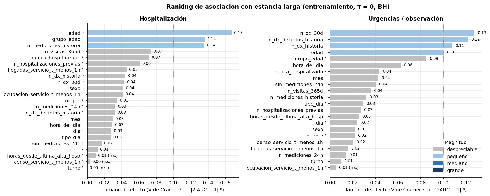
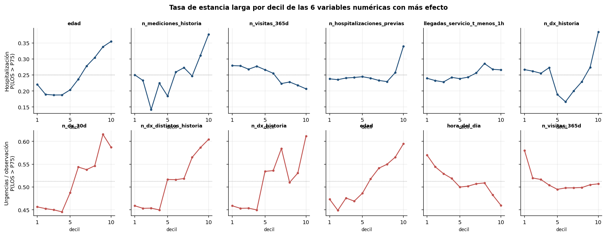
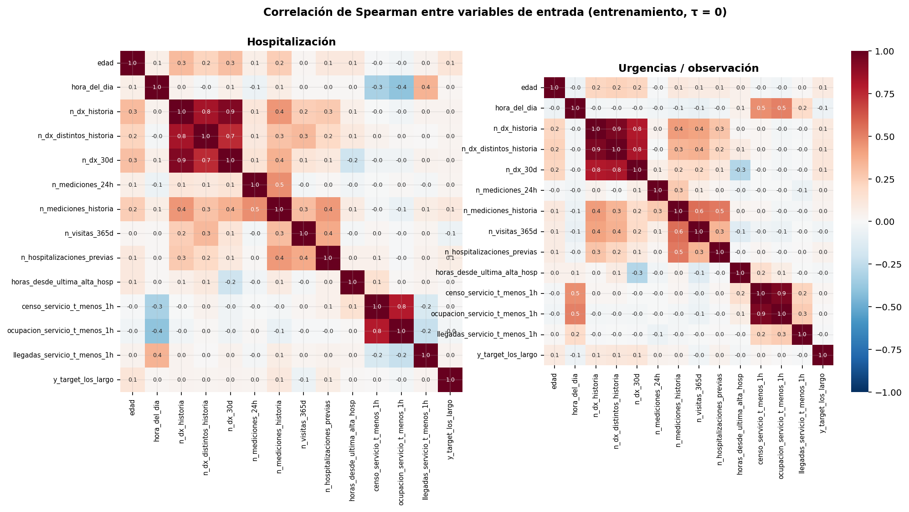
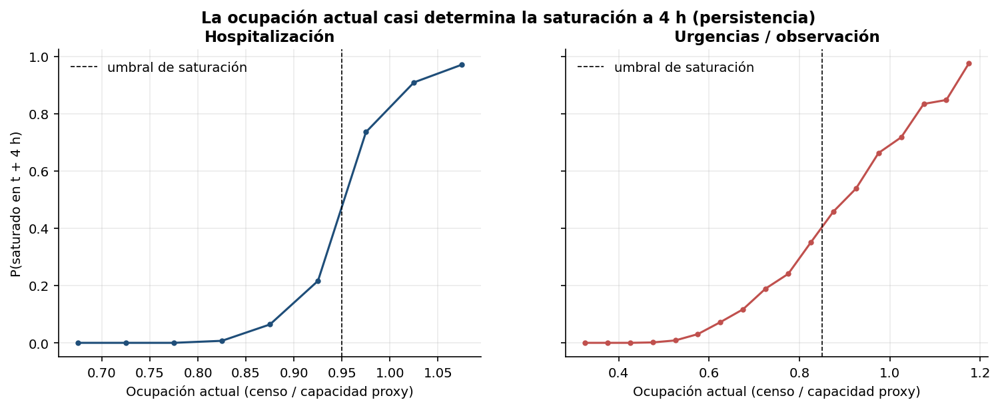
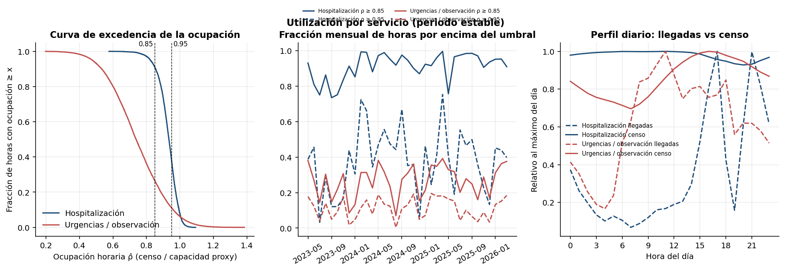
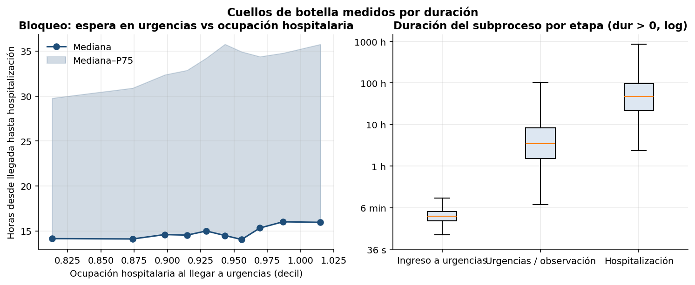

# M3 · EDA bivariado, tamaños de efecto y colas (HUN-202)

Persona 3 · generado por `m3_bivariado/run_m3.py` · pruebas bivariadas sobre **entrenamiento** del periodo estable; colas sobre todo el periodo estable. Solo agregados.

**Resumen ejecutivo**

- Con n de decenas o cientos de miles todo sale p < 0.001: se ordena por tamaño de efecto (V de Cramér, ε², AUC) con BH.
- Ninguna variable tiene por sí sola un efecto grande sobre la estancia larga. Las más fuertes son historia de uso/diagnósticos, edad y mediciones.
- El calendario afecta a las llegadas, pero casi nada a la estancia individual.
- Saturación a 4 h: la ocupación actual es un baseline de persistencia muy fuerte (AUC alta). El modelo tiene que superarlo.
- La espera registrada entre subprocesos es ~0: los cuellos de botella se miden por duración y ocupación.
- Hospitalización es el cuello de botella (ρ ≈ 0.93 respecto al proxy). Su censo crece porque las estancias se alargan, no porque lleguen más pacientes.
- Urgencias → cama de hospitalización tarda una mediana de ~14 h. Depende poco de la ocupación al llegar (señal débil de boarding).
- Turnos críticos: mañana en hospitalización (altas tardías) y tarde en urgencias.

## 1. Asociación bivariada con el target de paciente (LOS > P75)

Unidad: snapshot τ = 0 (uno por episodio), **solo entrenamiento** del periodo estable (hospitalización n = 34,634; urgencias/observación n = 170,960; en urgencias, τ = 0 excluye las estancias de LOS 0).

- **Categóricas**: Chi² de independencia + **V de Cramér** con corrección de sesgo.
- **Numéricas**: Mann-Whitney / Kruskal-Wallis + **ε²**, **AUC univariada** (P(X₁ > X₀)), diferencia de medianas (positivos − negativos) con **IC 95 % bootstrap**.
- Todos los p-valores se corrigen por **Benjamini-Hochberg** dentro de cada servicio. Las magnitudes siguen a Cohen (V) y Tomczak (ε²); para el AUC se usa |2·AUC − 1| con cortes 0.1/0.3/0.5.

**Hospitalización** (ordenado por tamaño de efecto):

| variable                      | tipo       | métrica   |   efecto | magnitud     | p_BH    | detalle                                             |
|:------------------------------|:-----------|:----------|---------:|:-------------|:--------|:----------------------------------------------------|
| edad                          | numérica   | |2AUC−1|  |    0.167 | pequeño      | < 0.001 | AUC=0.584; ε²=0.0157; Δmed=13.00 [11.00, 14.00]     |
| grupo_edad                    | categórica | V Cramér  |    0.136 | pequeño      | < 0.001 | tasa 15-44=0.20 … 80+=0.36                          |
| n_mediciones_historia         | numérica   | |2AUC−1|  |    0.136 | pequeño      | < 0.001 | AUC=0.568; ε²=0.0104; Δmed=21.00 [16.00, 23.00]     |
| n_visitas_365d                | numérica   | |2AUC−1|  |    0.074 | despreciable | < 0.001 | AUC=0.463; ε²=0.0033; Δmed=0.00 [0.00, 0.00]        |
| nunca_hospitalizado           | categórica | V Cramér  |    0.072 | despreciable | < 0.001 | tasa sí=0.24 … no=0.32                              |
| n_hospitalizaciones_previas   | numérica   | |2AUC−1|  |    0.061 | despreciable | < 0.001 | AUC=0.530; ε²=0.0054; Δmed=0.00 [0.00, 0.00]        |
| llegadas_servicio_t_menos_1h  | numérica   | |2AUC−1|  |    0.046 | despreciable | < 0.001 | AUC=0.523; ε²=0.0012; Δmed=1.00 [1.00, 2.00]        |
| n_dx_historia                 | numérica   | |2AUC−1|  |    0.044 | despreciable | < 0.001 | AUC=0.522; ε²=0.0011; Δmed=3.00 [-4.00, 6.00]       |
| n_dx_30d                      | numérica   | |2AUC−1|  |    0.043 | despreciable | < 0.001 | AUC=0.522; ε²=0.0011; Δmed=-3.00 [-7.00, 2.00]      |
| sexo                          | categórica | V Cramér  |    0.042 | despreciable | < 0.001 | tasa F=0.23 … M=0.27                                |
| ocupacion_servicio_t_menos_1h | numérica   | |2AUC−1|  |    0.041 | despreciable | < 0.001 | AUC=0.479; ε²=0.0010; Δmed=-0.00 [-0.01, -0.00]     |
| origen                        | categórica | V Cramér  |    0.035 | despreciable | < 0.001 | tasa directo=0.16 … urgencias=0.25                  |
| n_mediciones_24h              | numérica   | |2AUC−1|  |    0.032 | despreciable | < 0.001 | AUC=0.516; ε²=0.0006; Δmed=1.00 [0.00, 3.00]        |
| n_dx_distintos_historia       | numérica   | |2AUC−1|  |    0.032 | despreciable | < 0.001 | AUC=0.516; ε²=0.0006; Δmed=0.00 [0.00, 0.00]        |
| mes                           | categórica | V Cramér  |    0.030 | despreciable | < 0.001 | tasa 4=0.23 … 10=0.28                               |
| hora_del_dia                  | numérica   | |2AUC−1|  |    0.029 | despreciable | < 0.001 | AUC=0.515; ε²=0.0005; Δmed=0.00 [0.00, 0.00]        |
| dia                           | categórica | V Cramér  |    0.028 | despreciable | < 0.001 | tasa Lun=0.23 … Sáb=0.27                            |
| tipo_dia                      | categórica | V Cramér  |    0.027 | despreciable | < 0.001 | tasa día después festivo=0.22 … festivo=0.27        |
| sin_mediciones_24h            | categórica | V Cramér  |    0.017 | despreciable | 0.001   | tasa sí=0.24 … no=0.26                              |
| puente                        | categórica | V Cramér  |    0.012 | despreciable | 0.016   | tasa False=0.25 … True=0.27                         |
| horas_desde_ultima_alta_hosp  | numérica   | |2AUC−1|  |    0.010 | despreciable | 0.598   | AUC=0.505; ε²=0.0001; Δmed=112.84 [-105.23, 341.72] |
| censo_servicio_t_menos_1h     | numérica   | |2AUC−1|  |    0.003 | despreciable | 0.689   | AUC=0.501; ε²=0.0000; Δmed=0.00 [0.00, 1.00]        |
| turno                         | categórica | V Cramér  |    0.000 | despreciable | 0.581   | tasa mañana=0.24 … noche=0.25                       |

**Urgencias / observación** (ordenado por tamaño de efecto):

| variable                      | tipo       | métrica   |   efecto | magnitud     | p_BH    | detalle                                              |
|:------------------------------|:-----------|:----------|---------:|:-------------|:--------|:-----------------------------------------------------|
| n_dx_30d                      | numérica   | |2AUC−1|  |    0.128 | pequeño      | < 0.001 | AUC=0.564; ε²=0.0141; Δmed=3.00 [3.00, 3.00]         |
| n_dx_distintos_historia       | numérica   | |2AUC−1|  |    0.122 | pequeño      | < 0.001 | AUC=0.561; ε²=0.0122; Δmed=0.00 [0.00, 0.00]         |
| n_dx_historia                 | numérica   | |2AUC−1|  |    0.108 | pequeño      | < 0.001 | AUC=0.554; ε²=0.0094; Δmed=0.00 [0.00, 0.00]         |
| edad                          | numérica   | |2AUC−1|  |    0.100 | pequeño      | < 0.001 | AUC=0.550; ε²=0.0075; Δmed=5.00 [4.00, 5.00]         |
| grupo_edad                    | categórica | V Cramér  |    0.085 | despreciable | < 0.001 | tasa 0-14=0.46 … 80+=0.60                            |
| hora_del_dia                  | numérica   | |2AUC−1|  |    0.062 | despreciable | < 0.001 | AUC=0.469; ε²=0.0029; Δmed=-1.00 [-1.00, -1.00]      |
| nunca_hospitalizado           | categórica | V Cramér  |    0.044 | despreciable | < 0.001 | tasa sí=0.51 … no=0.58                               |
| mes                           | categórica | V Cramér  |    0.042 | despreciable | < 0.001 | tasa 8=0.48 … 5=0.55                                 |
| sin_mediciones_24h            | categórica | V Cramér  |    0.040 | despreciable | < 0.001 | tasa sí=0.51 … no=0.62                               |
| n_visitas_365d                | numérica   | |2AUC−1|  |    0.036 | despreciable | < 0.001 | AUC=0.482; ε²=0.0010; Δmed=0.00 [0.00, 0.00]         |
| n_mediciones_historia         | numérica   | |2AUC−1|  |    0.032 | despreciable | < 0.001 | AUC=0.516; ε²=0.0012; Δmed=0.00 [0.00, 0.00]         |
| tipo_dia                      | categórica | V Cramér  |    0.029 | despreciable | < 0.001 | tasa festivo=0.46 … laboral=0.52                     |
| n_hospitalizaciones_previas   | numérica   | |2AUC−1|  |    0.027 | despreciable | < 0.001 | AUC=0.514; ε²=0.0020; Δmed=0.00 [0.00, 0.00]         |
| horas_desde_ultima_alta_hosp  | numérica   | |2AUC−1|  |    0.026 | despreciable | 0.004   | AUC=0.487; ε²=0.0005; Δmed=-227.35 [-392.72, -86.88] |
| dia                           | categórica | V Cramér  |    0.024 | despreciable | < 0.001 | tasa Dom=0.49 … Mar=0.53                             |
| sexo                          | categórica | V Cramér  |    0.022 | despreciable | < 0.001 | tasa F=0.50 … desconocido=0.60                       |
| puente                        | categórica | V Cramér  |    0.022 | despreciable | < 0.001 | tasa True=0.48 … False=0.52                          |
| censo_servicio_t_menos_1h     | numérica   | |2AUC−1|  |    0.020 | despreciable | < 0.001 | AUC=0.510; ε²=0.0003; Δmed=2.00 [0.00, 2.00]         |
| llegadas_servicio_t_menos_1h  | numérica   | |2AUC−1|  |    0.016 | despreciable | < 0.001 | AUC=0.492; ε²=0.0002; Δmed=-1.00 [-1.00, 0.00]       |
| n_mediciones_24h              | numérica   | |2AUC−1|  |    0.014 | despreciable | < 0.001 | AUC=0.507; ε²=0.0017; Δmed=0.00 [0.00, 0.00]         |
| turno                         | categórica | V Cramér  |    0.010 | despreciable | < 0.001 | tasa tarde=0.51 … mañana=0.52                        |
| ocupacion_servicio_t_menos_1h | numérica   | |2AUC−1|  |    0.005 | despreciable | 0.069   | AUC=0.503; ε²=0.0000; Δmed=0.00 [-0.00, 0.01]        |

**Pares con |ρ de Spearman| ≥ 0.7 (redundancia para M5):**

| servicio                | var_1                     | var_2                         |   rho |
|:------------------------|:--------------------------|:------------------------------|------:|
| Hospitalización         | n_dx_historia             | n_dx_distintos_historia       |  0.83 |
| Hospitalización         | n_dx_historia             | n_dx_30d                      |  0.93 |
| Hospitalización         | n_dx_distintos_historia   | n_dx_30d                      |  0.74 |
| Hospitalización         | censo_servicio_t_menos_1h | ocupacion_servicio_t_menos_1h |  0.80 |
| Urgencias / observación | n_dx_historia             | n_dx_distintos_historia       |  0.94 |
| Urgencias / observación | n_dx_historia             | n_dx_30d                      |  0.80 |
| Urgencias / observación | n_dx_distintos_historia   | n_dx_30d                      |  0.82 |
| Urgencias / observación | censo_servicio_t_menos_1h | ocupacion_servicio_t_menos_1h |  0.94 |

**Lectura.**

- Hospitalización: las variables con más efecto son `edad` (0.17, pequeño), `grupo_edad` (0.14, pequeño), `n_mediciones_historia` (0.14, pequeño), `n_visitas_365d` (0.07, despreciable).

- Urgencias/observación: `n_dx_30d` (0.13, pequeño), `n_dx_distintos_historia` (0.12, pequeño), `n_dx_historia` (0.11, pequeño), `edad` (0.10, pequeño).

- Casi todo es estadísticamente significativo tras BH, pero **ninguna variable tiene por sí sola un efecto grande**: el target de paciente es multifactorial y el modelo tendrá que combinar historia clínica, edad y carga del servicio. Las variables de calendario (día, turno, festivo) tienen efecto despreciable sobre la estancia del paciente, aunque sí afectan a las llegadas (M4).

- Las variables de diagnósticos y mediciones están muy correlacionadas entre sí: conviene reducirlas (SVD o selección L1, M5) o usar modelos robustos a la colinealidad.

## 2. Estancia continua por grupos (Kruskal-Wallis + ε²)

| servicio                | variable            |     ε² | magnitud     | p_BH    | mediana LOS por grupo (h)                                                    |
|:------------------------|:--------------------|-------:|:-------------|:--------|:-----------------------------------------------------------------------------|
| Hospitalización         | grupo_edad          | 0.0186 | pequeño      | < 0.001 | 0-14: 69.0; 15-44: 62.9; 45-64: 74.8; 65-79: 93.0; 80+: 95.8                 |
| Hospitalización         | origen              | 0.0144 | pequeño      | < 0.001 | directo: 24.7; urgencias: 70.6                                               |
| Hospitalización         | nunca_hospitalizado | 0.0082 | despreciable | < 0.001 | no: 90.5; sí: 67.9                                                           |
| Hospitalización         | sin_mediciones_24h  | 0.0033 | despreciable | < 0.001 | no: 71.9; sí: 66.9                                                           |
| Hospitalización         | tipo_dia            | 0.0023 | despreciable | < 0.001 | día después festivo: 66.4; festivo: 72.0; fin de semana: 73.8; laboral: 68.4 |
| Hospitalización         | dia                 | 0.0022 | despreciable | < 0.001 | Dom: 71.4; Jue: 69.2; Lun: 66.9; Mar: 67.6; Mié: 66.7; Sáb: 77.5; Vie: 70.8  |
| Hospitalización         | sexo                | 0.0012 | despreciable | < 0.001 | F: 67.8; M: 72.7                                                             |
| Hospitalización         | turno               | 0.0007 | despreciable | < 0.001 | mañana: 60.4; noche: 68.6; tarde: 71.1                                       |
| Urgencias / observación | grupo_edad          | 0.0089 | despreciable | < 0.001 | 0-14: 8.1; 15-44: 8.7; 45-64: 9.9; 65-79: 10.5; 80+: 11.3                    |
| Urgencias / observación | nunca_hospitalizado | 0.0025 | despreciable | < 0.001 | no: 10.6; sí: 9.0                                                            |
| Urgencias / observación | sin_mediciones_24h  | 0.0024 | despreciable | < 0.001 | no: 13.4; sí: 9.1                                                            |
| Urgencias / observación | tipo_dia            | 0.0008 | despreciable | < 0.001 | día después festivo: 9.2; festivo: 8.1; fin de semana: 8.8; laboral: 9.3     |
| Urgencias / observación | dia                 | 0.0007 | despreciable | < 0.001 | Dom: 8.6; Jue: 9.3; Lun: 9.0; Mar: 9.4; Mié: 9.2; Sáb: 9.0; Vie: 9.3         |
| Urgencias / observación | sexo                | 0.0006 | despreciable | < 0.001 | F: 9.0; M: 9.5; desconocido: 9.1                                             |
| Urgencias / observación | turno               | 0.0002 | despreciable | < 0.001 | mañana: 9.2; noche: 9.2; tarde: 9.0                                          |

## 3. Asociación con el target de servicio (saturación en t + 4 h)

Unidad: servicio × hora (entrenamiento, periodo estable). **Advertencia**: las horas consecutivas están autocorrelacionadas, así que los p-valores son optimistas; lo informativo es el tamaño de efecto.

| servicio                | variable       | métrica   |   efecto | magnitud     | p_BH    |
|:------------------------|:---------------|:----------|---------:|:-------------|:--------|
| Hospitalización         | turno          | V Cramér  |    0.277 | pequeño      | < 0.001 |
| Hospitalización         | dia_semana     | V Cramér  |    0.036 | despreciable | < 0.001 |
| Hospitalización         | mes            | V Cramér  |    0.200 | pequeño      | < 0.001 |
| Hospitalización         | festivo        | V Cramér  |    0.030 | despreciable | < 0.001 |
| Hospitalización         | fin_de_semana  | V Cramér  |    0.011 | despreciable | 0.082   |
| Hospitalización         | hora_del_dia   | V Cramér  |    0.309 | mediano      | < 0.001 |
| Hospitalización         | ocupacion      | AUC       |    0.892 | grande       | < 0.001 |
| Hospitalización         | censo          | AUC       |    0.797 | grande       | < 0.001 |
| Hospitalización         | llegadas       | AUC       |    0.456 | despreciable | < 0.001 |
| Hospitalización         | llegadas_4h    | AUC       |    0.472 | despreciable | < 0.001 |
| Hospitalización         | delta_censo_4h | AUC       |    0.635 | pequeño      | < 0.001 |
| Hospitalización         | capacidad      | AUC       |    0.504 | despreciable | 0.294   |
| Urgencias / observación | turno          | V Cramér  |    0.407 | mediano      | < 0.001 |
| Urgencias / observación | dia_semana     | V Cramér  |    0.265 | pequeño      | < 0.001 |
| Urgencias / observación | mes            | V Cramér  |    0.173 | pequeño      | < 0.001 |
| Urgencias / observación | festivo        | V Cramér  |    0.104 | pequeño      | < 0.001 |
| Urgencias / observación | fin_de_semana  | V Cramér  |    0.246 | pequeño      | < 0.001 |
| Urgencias / observación | hora_del_dia   | V Cramér  |    0.456 | mediano      | < 0.001 |
| Urgencias / observación | ocupacion      | AUC       |    0.835 | grande       | < 0.001 |
| Urgencias / observación | censo          | AUC       |    0.817 | grande       | < 0.001 |
| Urgencias / observación | llegadas       | AUC       |    0.774 | grande       | < 0.001 |
| Urgencias / observación | llegadas_4h    | AUC       |    0.821 | grande       | < 0.001 |
| Urgencias / observación | delta_censo_4h | AUC       |    0.780 | grande       | < 0.001 |
| Urgencias / observación | capacidad      | AUC       |    0.508 | despreciable | 0.098   |

**Lectura.** La ocupación actual sola tiene AUC = 0.892 (hosp.) y 0.835 (urg.) para predecir la saturación a 4 h: es un **baseline de persistencia** muy fuerte que Persona 2 debe reportar como referencia mínima. La **hora del día** tiene efecto mediano en ambos servicios (V ≈ 0.31 hosp., 0.46 urg.) y el mes, efecto pequeño: hay que darle al modelo el ciclo diario (hora y turno) y la estacionalidad. En urgencias también pesan las llegadas de las últimas 4 h (AUC 0.82) y el cambio de censo en 4 h (0.78); en hospitalización las llegadas casi no informan (AUC ≈ 0.46): lo que la satura es que las altas no liberen camas.

## 4. Teoría de colas por servicio

Tabla de Persona 1 (`resumen_colas`, periodo estable). λ = llegadas/h, E[S] = duración media del subproceso, μ = 1/E[S], L = censo medio, c = capacidad proxy media, ρ = λ·E[S]/c.

| servicio              |   lambda_por_hora |   estancia_media_h |   mu_por_hora |   estancia_p50_h |   estancia_p90_h |   n_subprocesos |   censo_prom_L |   little_lambda_x_W |   capacidad_media_c |   rho_aprox |
|:----------------------|------------------:|-------------------:|--------------:|-----------------:|-----------------:|----------------:|---------------:|--------------------:|--------------------:|------------:|
| ambulatorio           |            51.445 |              0.000 |       nan     |            0.000 |            0.000 |         1427228 |        nan     |               0.000 |             nan     |     nan     |
| hospitalizacion       |             3.586 |             80.506 |         0.012 |           45.729 |          187.358 |           99483 |        289.500 |             288.700 |             311.900 |       0.926 |
| urgencias_ingreso     |            16.100 |              0.355 |         2.819 |            0.054 |            0.097 |          446657 |        nan     |               5.700 |             nan     |     nan     |
| urgencias_observacion |            38.364 |              5.828 |         0.172 |            1.178 |           12.476 |         1064329 |        224.000 |             223.600 |             301.200 |       0.742 |

La **ley de Little** (L = λ·W) cuadra en los dos servicios con estancia (error < 0.5 %), lo que valida que censo, llegadas y duraciones son coherentes entre sí.

**Por año** (λ y W desde `detalle`; L, c y fracción de horas con ocupación ≥ umbral desde `ocupacion_servicio_hora`, ambos sobre las mismas horas; 2023 empieza en mayo por la ventana de 90 días de la capacidad):

| servicio              |   anio |   lambda_h |    W_h |       L |   little_lambdaW |       c |   rho |   frac_085 |   frac_095 |   frac_100 |   horas |
|:----------------------|-------:|-----------:|-------:|--------:|-----------------:|--------:|------:|-----------:|-----------:|-----------:|--------:|
| hospitalizacion       |   2023 |      3.420 | 77.636 | 265.893 |          265.524 | 293.632 | 0.904 |      0.824 |      0.251 |      0.068 |    5879 |
| hospitalizacion       |   2024 |      3.684 | 78.179 | 286.783 |          288.019 | 306.341 | 0.940 |      0.936 |      0.449 |      0.101 |    8784 |
| hospitalizacion       |   2025 |      3.633 | 84.783 | 304.368 |          308.055 | 326.249 | 0.944 |      0.939 |      0.393 |      0.079 |    8760 |
| hospitalizacion       |   2026 |      3.517 | 85.221 | 304.825 |          299.695 | 326.272 | 0.919 |      0.937 |      0.429 |      0.056 |    2156 |
| urgencias_observacion |   2023 |     40.668 |  5.107 | 197.428 |          207.703 | 276.016 | 0.753 |      0.232 |      0.102 |      0.057 |    5879 |
| urgencias_observacion |   2024 |     39.886 |  5.265 | 212.755 |          209.994 | 287.419 | 0.731 |      0.257 |      0.111 |      0.063 |    8784 |
| urgencias_observacion |   2025 |     36.122 |  6.914 | 248.115 |          249.736 | 328.719 | 0.760 |      0.274 |      0.109 |      0.059 |    8760 |
| urgencias_observacion |   2026 |     32.530 |  7.466 | 244.019 |          242.879 | 314.528 | 0.772 |      0.350 |      0.156 |      0.097 |    2156 |

**Lectura.** En hospitalización L y W crecen año a año con λ casi constante: el censo sube porque las estancias se alargan (coherente con la deriva del M2), no porque lleguen más pacientes. En urgencias/observación λ baja y W sube. Es la misma firma del cambio de registro visto en el M2: hay menos subprocesos y más largos, y el producto λ·W apenas cambia.

**Por turno** (mañana 7–13, tarde 13–19, noche 19–7):

| servicio              | turno   |   ocupacion_media |   frac_085 |   frac_095 |   llegadas_h |
|:----------------------|:--------|------------------:|-----------:|-----------:|-------------:|
| hospitalizacion       | manana  |             0.947 |      0.958 |      0.523 |        1.335 |
| hospitalizacion       | noche   |             0.921 |      0.890 |      0.329 |        3.780 |
| hospitalizacion       | tarde   |             0.924 |      0.908 |      0.348 |        5.473 |
| urgencias_observacion | manana  |             0.686 |      0.123 |      0.032 |       52.584 |
| urgencias_observacion | noche   |             0.718 |      0.206 |      0.080 |       25.739 |
| urgencias_observacion | tarde   |             0.849 |      0.524 |      0.256 |       48.556 |

**Desfase llegadas → censo** (correlación cruzada de las series sin tendencia semanal):

| servicio                |   hora pico llegadas |   hora pico censo |   desfase de máx. correlación (h) |   corr máx |
|:------------------------|---------------------:|------------------:|----------------------------------:|-----------:|
| Hospitalización         |                   17 |                11 |                                13 |       0.23 |
| Urgencias / observación |                   11 |                16 |                                 4 |       0.54 |

## 5. Cuellos de botella: duración por etapa, espera y bloqueo urgencias → hospitalización

**Duración de cada subproceso** (`detalle`, periodo estable):

| servicio              |       n |   media_h |   p50_h |   p75_h |   p90_h |   p99_h |   frac_cero |
|:----------------------|--------:|----------:|--------:|--------:|--------:|--------:|------------:|
| hospitalizacion       |   99483 |    80.506 |  45.729 |  95.174 | 187.358 | 531.585 |       0.034 |
| urgencias_observacion | 1064329 |     5.828 |   1.178 |   4.665 |  12.476 |  73.490 |       0.385 |
| urgencias_ingreso     |  446657 |     0.355 |   0.054 |   0.073 |   0.097 |   0.185 |       0.228 |
| ambulatorio           | 1427228 |     0.000 |   0.000 |   0.000 |   0.000 |   0.000 |       1.000 |

**Espera entre subprocesos** (transiciones con n ≥ 1 000, `matriz_transicion`):

| desde                 | hacia                 |      n |   prob |   espera_p50_h |   espera_p75_h |   espera_p90_h |   frac_solapada |   duracion_desde_p50_h |
|:----------------------|:----------------------|-------:|-------:|---------------:|---------------:|---------------:|----------------:|-----------------------:|
| ambulatorio           | urgencias_observacion |  10520 |  0.011 |          0.067 |          0.088 |          0.135 |           0.000 |                  0.000 |
| ambulatorio           | ambulatorio           |   2303 |  0.002 |          1.272 |          7.625 |        120.322 |           0.000 |                  0.000 |
| hospitalizacion       | hospitalizacion       |  24885 |  0.360 |          0.000 |          0.000 |          0.000 |           0.044 |                 24.696 |
| urgencias_ingreso     | urgencias_observacion | 273768 |  0.770 |         -0.000 |         -0.000 |         -0.000 |           0.974 |                  0.062 |
| urgencias_observacion | urgencias_observacion | 293497 |  0.404 |          0.000 |          0.000 |          0.000 |           0.010 |                  2.186 |
| urgencias_observacion | hospitalizacion       |  42924 |  0.059 |          0.000 |          0.000 |         18.210 |           0.000 |                  7.642 |

La espera registrada entre subprocesos es **0 en la mediana y el P75** de todas las transiciones frecuentes: el fin de un registro es el inicio del siguiente. Los datos **no registran colas de espera** (no hay triaje → consulta → exámenes). El cuello de botella hay que medirlo con la **duración** de la etapa previa y con la **ocupación**.

**Bloqueo urgencias → hospitalización (boarding).** Para las 40,520 visitas del periodo estable que entran por urgencias y terminan hospitalizadas, se mide el tiempo desde la llegada hasta el ingreso a hospitalización y se cruza con la ocupación hospitalaria en la hora de llegada:

|   decil_ocup |   ocup_media |       n |   mediana_h |   p75_h |   p90_h |
|-------------:|-------------:|--------:|------------:|--------:|--------:|
|         1.00 |         0.81 | 4052.00 |       14.13 |   29.78 |   54.76 |
|         2.00 |         0.87 | 4062.00 |       14.10 |   30.90 |   58.04 |
|         3.00 |         0.90 | 4050.00 |       14.59 |   32.38 |   58.76 |
|         4.00 |         0.91 | 4060.00 |       14.53 |   32.88 |   60.76 |
|         5.00 |         0.93 | 4062.00 |       14.99 |   34.23 |   60.91 |
|         6.00 |         0.94 | 4032.00 |       14.48 |   35.78 |   65.84 |
|         7.00 |         0.96 | 4058.00 |       14.04 |   34.94 |   61.73 |
|         8.00 |         0.97 | 4055.00 |       15.32 |   34.40 |   60.71 |
|         9.00 |         0.99 | 4039.00 |       16.01 |   34.79 |   59.91 |
|        10.00 |         1.01 | 4050.00 |       15.95 |   35.77 |   61.65 |

Kruskal-Wallis entre deciles: ε² = 0.0025 (despreciable), p = < 0.001; Spearman ρ = 0.048. Diferencia de medianas decil 10 − decil 1 = 1.82 h [IC 95 % 0.29, 3.36].

**Lectura de colas.**

- **Hospitalización es el cuello de botella del sistema**: ρ ≈ 0.93 respecto a su propio P95 reciente, con ocupación ≥ 0.85 en el 91 % de las horas. Recibe pocas llegadas (≈ 3.6/h) pero cada una ocupa una cama ~80 h, de modo que pequeñas variaciones de llegadas o de estancia saturan el servicio.

- **Ciclo diario de hospitalización**: el censo llega al máximo hacia las 11 h y las llegadas hacia las 17 h. La mañana es el turno más lleno (ρ ≥ 0.95 en ~52 % de las horas, frente a ~33–35 % en tarde y noche): las camas se liberan con las altas del mediodía. Las alertas de saturación hospitalaria se concentrarán en la mañana.

- Urgencias/observación tiene muchas llegadas (≈ 38/h) y estancias cortas. Las llegadas pican hacia las 11 h y el censo ~4–5 h después (16 h); la **tarde** es el turno crítico (ocupación ≥ 0.85 en ~52 % de sus horas, frente a 12 % en la mañana).

- **Tiempo hasta cama**: quien entra por urgencias y termina hospitalizado tarda una mediana de ~15 h desde la llegada hasta el ingreso a hospitalización (P75 ~34 h). Ese es el mayor tiempo "de paso" del sistema. Con más ocupación hospitalaria ese tiempo crece, pero poco (+1.8 h entre el decil 10 y el 1; ε² despreciable). Hay una señal débil de *boarding*: la mayor parte de la espera no se explica por la ocupación en el momento de llegar.

- Advertencia: la capacidad es un proxy (P95 móvil del censo). ρ mide qué tan cerca está el servicio de su máximo reciente, no de las camas reales. Con el número real de camas, ρ y la fracción de horas saturadas cambiarán.
