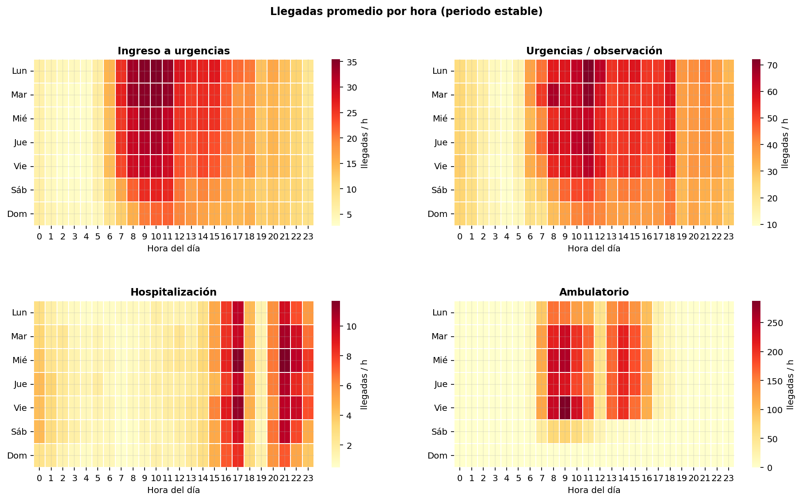
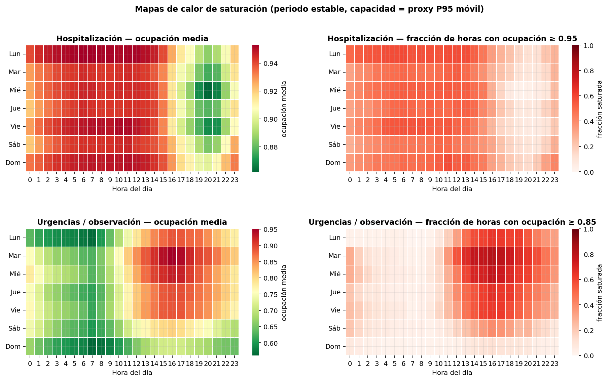
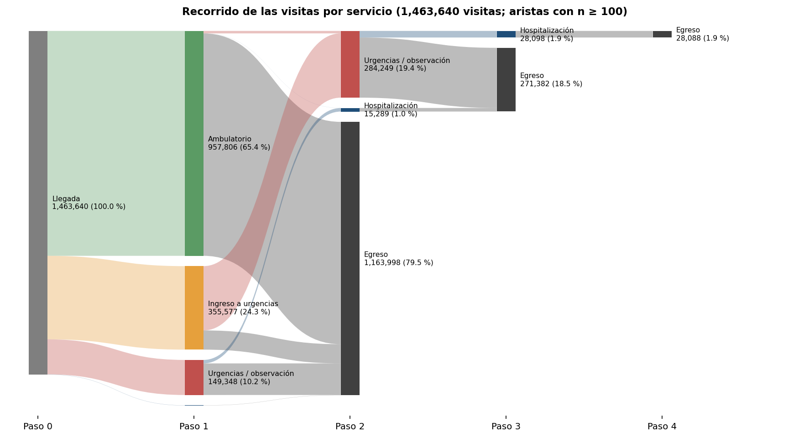
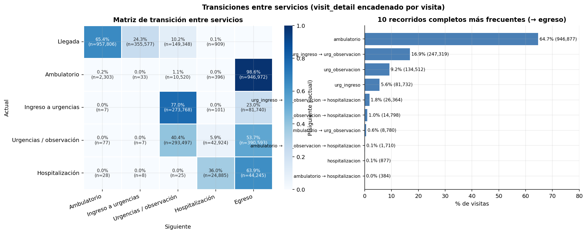
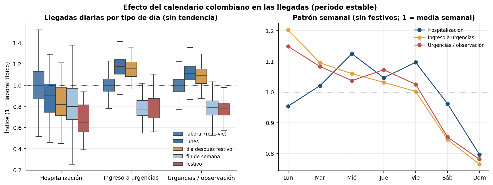
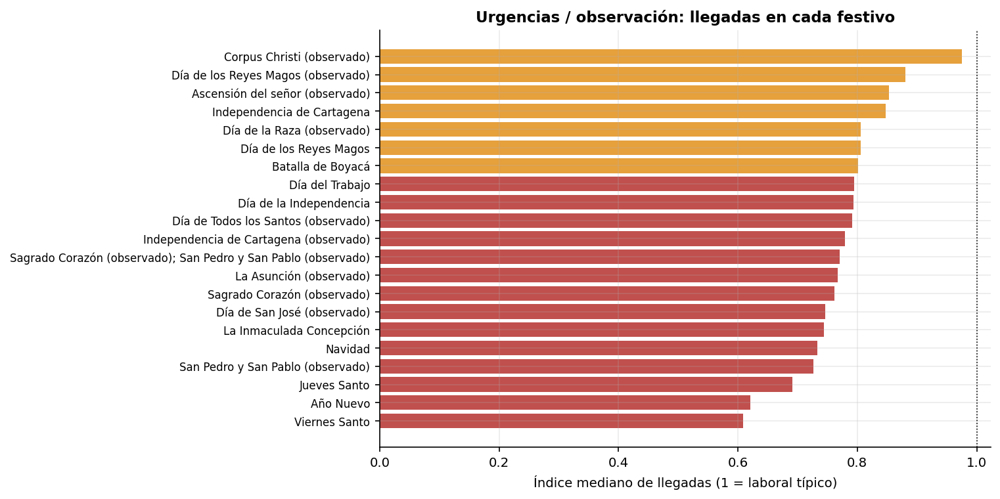
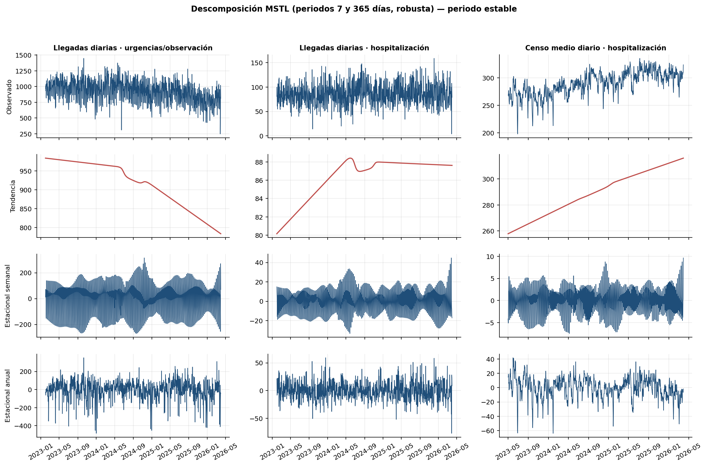
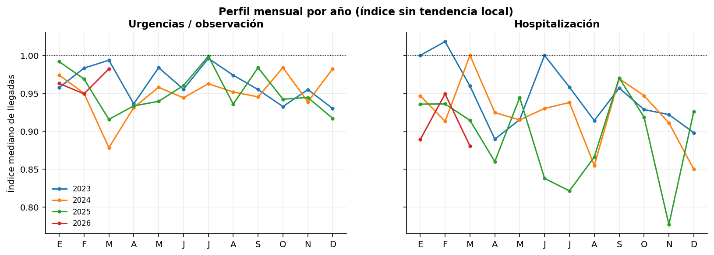
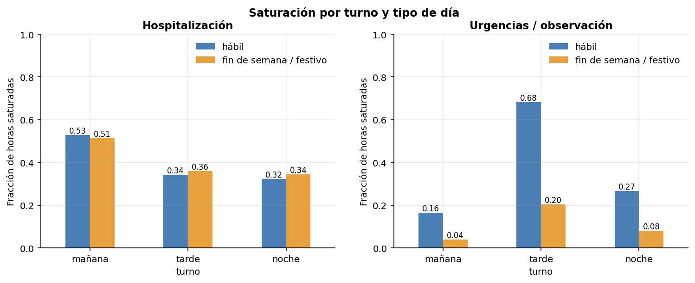
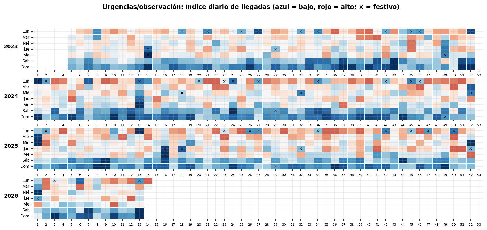

# M4 · EDA espacio-temporal y dinámica de ocupación — parte visual (HUN-203)

Persona 3 · generado por `m4_visual/run_m4_visual.py` sobre las tablas `data/m4/*` de Persona 1 · periodo estable. Los HTML interactivos (`html/`) son para el dashboard (M8). Para verlos hace falta conexión, porque cargan plotly.js desde CDN.

**Resumen ejecutivo**

- Las llegadas siguen un ciclo diario y semanal muy fuerte (pico entre semana a las 10–11 h). La saturación de urgencias llega por la tarde y la de hospitalización por la mañana.
- El 65 % de las visitas son ambulatorias aisladas. Hospitalización se alimenta casi solo de observación de urgencias (≈ 6 % de conversión).
- Festivo ≈ domingo. El "rebote" tras festivo es sobre todo un efecto de primer día hábil (los lunes normales rebotan igual). La columna `dia_despues_festivo` de Persona 1 incluye los lunes normales y hay que corregirla.
- Hospitalización satura de madrugada y por la mañana, con el máximo los lunes (pocas altas en fin de semana).
- El censo hospitalario tiene una tendencia creciente. Las llegadas a urgencias muestran una tendencia a la baja que coincide con un cambio de registro.
- Los umbrales de alerta deberían fijarse por servicio y turno.

## 1. Densidad de admisiones por día de la semana × hora

| servicio                | pico      |   llegadas_pico_h |   llegadas_valle_h |   razón pico/valle |   llegadas_prom_h |
|:------------------------|:----------|------------------:|-------------------:|-------------------:|------------------:|
| Ingreso a urgencias     | Lun 10:00 |              35.5 |                2.7 |               13.0 |              16.1 |
| Urgencias / observación | Lun 11:00 |              72.1 |                9.4 |                7.6 |              38.4 |
| Hospitalización         | Mié 21:00 |              11.7 |                0.5 |               23.5 |               3.6 |
| Ambulatorio             | Vie 9:00  |             287.4 |                0.0 |            28741.2 |              51.4 |

**Franjas con más horas saturadas** (top 5 por servicio):

| servicio              | dia   |   hora_del_dia |   ocupacion_prom |   frac_horas_saturadas |
|:----------------------|:------|---------------:|-----------------:|-----------------------:|
| urgencias_observacion | Mar   |             16 |            0.951 |                  0.817 |
| urgencias_observacion | Mar   |             17 |            0.943 |                  0.797 |
| urgencias_observacion | Mar   |             15 |            0.938 |                  0.778 |
| urgencias_observacion | Mar   |             14 |            0.914 |                  0.771 |
| urgencias_observacion | Mié   |             16 |            0.926 |                  0.770 |
| hospitalizacion       | Lun   |              6 |            0.953 |                  0.588 |
| hospitalizacion       | Lun   |              4 |            0.951 |                  0.582 |
| hospitalizacion       | Lun   |             12 |            0.952 |                  0.582 |
| hospitalizacion       | Lun   |              5 |            0.952 |                  0.582 |
| hospitalizacion       | Lun   |             11 |            0.952 |                  0.582 |

**Lectura.**

- **Urgencias (ingreso y observación)**: las llegadas son muy diurnas, con pico a media mañana (≈ 10–11 h) de lunes a viernes, valle a las 3–5 h y fines de semana más planos. La saturación de observación llega con 4–6 h de retraso: se concentra **por la tarde, de lunes a viernes, sobre todo martes y miércoles entre las 14 y las 17 h**.

- **Ambulatorio**: solo en horario hábil (7–17 h, lunes a viernes), con un hueco al mediodía (12 h). Prácticamente no hay actividad el fin de semana.

- **Hospitalización**: las llegadas se concentran en **dos franjas exactas, 16–17 h y 20–22 h**, todos los días. Un patrón tan rígido parece la hora de **registro administrativo** (lotes por cambio de turno) más que la hora clínica de ingreso. Persona 2 debe tenerlo en cuenta: la `hora_del_dia` de ingreso a hospitalización refleja el proceso de registro. La saturación se da en la **madrugada y la mañana**, antes de las altas del mediodía, y es máxima el **lunes**: durante el fin de semana hay menos altas y las camas se acumulan.

## 2. Flujo de pacientes entre servicios (Sankey y matriz de transición)

Sankey interactivo: [`html/sankey_flujo.html`](html/sankey_flujo.html). Se omiten las aristas con menos de 100 visitas (25 de 42, 0.01 % del flujo).

**Lectura.**

- El 65 % de las visitas son una consulta ambulatoria aislada, y el 17 % sigue el circuito típico de urgencias (ingreso → observación → egreso).

- De los ingresos a hospitalización (sin contar registros encadenados del mismo servicio), el 97 % viene de observación de urgencias. Hospitalización es casi exclusivamente un destino de urgencias.

- Desde observación, el 54 % egresa, el 40 % pasa a otro registro de observación (cadenas de registros del mismo servicio) y el 6 % se hospitaliza. Ese 6 % es la tasa de conversión que alimenta la presión sobre camas.

- Las transiciones raras (hospitalización → urgencias, observación → ambulatorio) tienen esperas de cientos de horas: son reingresos dentro de la misma visita, no flujo operativo.

## 3. Efecto del calendario colombiano (festivos, puentes, día después de festivo)

Para separar el efecto del día de la tendencia de largo plazo, cada día se expresa como un **índice** = llegadas del día / mediana de los días laborales normales (martes–viernes) en ±14 días (1.0 = un día laboral típico de esas fechas).

> ⚠️ **Nota para Persona 1**: en `calendario_dia`, `dia_despues_festivo` está marcado en 174 días del periodo, pero solo 46 siguen a un festivo real. La columna marca el primer día hábil tras **cualquier** día no hábil, así que incluye los lunes normales tras un fin de semana. Por eso el "rebote" de `outputs/m4_resumen.md` (1 067/día) mezcla el efecto lunes con el efecto festivo. Aquí se separan: `lunes` (tras un fin de semana normal) y `día después festivo` (el día hábil siguiente a un festivo real). Sugiero renombrar la columna o añadir `tras_festivo`.

| servicio              | tipo_dia            |   dias |   llegadas_media |   indice_mediano |
|:----------------------|:--------------------|-------:|-----------------:|-----------------:|
| ambulatorio           | día después festivo |     46 |         1689.674 |            0.982 |
| ambulatorio           | festivo             |     54 |            5.352 |            0.002 |
| ambulatorio           | fin de semana       |    327 |          173.034 |            0.011 |
| ambulatorio           | laboral (mar–vie)   |    601 |         1805.291 |            1.000 |
| ambulatorio           | lunes               |    128 |         1622.281 |            0.913 |
| hospitalizacion       | día después festivo |     46 |           79.804 |            0.817 |
| hospitalizacion       | festivo             |     54 |           63.889 |            0.650 |
| hospitalizacion       | fin de semana       |    327 |           76.584 |            0.798 |
| hospitalizacion       | laboral (mar–vie)   |    601 |           94.300 |            1.000 |
| hospitalizacion       | lunes               |    128 |           83.164 |            0.900 |
| urgencias_ingreso     | día después festivo |     46 |          475.348 |            1.156 |
| urgencias_ingreso     | festivo             |     54 |          328.167 |            0.803 |
| urgencias_ingreso     | fin de semana       |    327 |          315.434 |            0.773 |
| urgencias_ingreso     | laboral (mar–vie)   |    601 |          405.448 |            1.000 |
| urgencias_ingreso     | lunes               |    128 |          470.688 |            1.177 |
| urgencias_observacion | día después festivo |     46 |         1057.804 |            1.094 |
| urgencias_observacion | festivo             |     54 |          758.204 |            0.776 |
| urgencias_observacion | fin de semana       |    327 |          762.789 |            0.788 |
| urgencias_observacion | laboral (mar–vie)   |    601 |          978.807 |            1.000 |
| urgencias_observacion | lunes               |    128 |         1070.555 |            1.113 |

| servicio                |   KW ε² (tipo de día, índice sin tendencia) | magnitud   | Δ día después festivo − laboral   | Δ lunes − laboral       |   índice mediano festivo de puente | p_BH    |
|:------------------------|--------------------------------------------:|:-----------|:----------------------------------|:------------------------|-----------------------------------:|:--------|
| Ambulatorio             |                                       0.668 | grande     | -0.018 [-0.087, +0.015]           | -0.087 [-0.120, -0.066] |                              0.003 | < 0.001 |
| Hospitalización         |                                       0.206 | mediano    | -0.183 [-0.241, -0.112]           | -0.100 [-0.132, -0.068] |                              0.633 | < 0.001 |
| Ingreso a urgencias     |                                       0.633 | grande     | +0.156 [+0.111, +0.187]           | +0.177 [+0.162, +0.195] |                              0.828 | < 0.001 |
| Urgencias / observación |                                       0.600 | grande     | +0.094 [+0.054, +0.139]           | +0.113 [+0.094, +0.133] |                              0.777 | < 0.001 |

**Lectura.**

- **Festivo ≈ domingo** en urgencias/observación: índice 0.78 frente a 0.79 en fin de semana.

- **El rebote existe, pero es sobre todo un efecto lunes**: el primer día hábil tras el descanso concentra la demanda acumulada. En urgencias/observación, lunes normal = 1.11 y día después de festivo = 1.09 (con la Ley Emiliani suele ser martes). Ingreso a urgencias se comporta igual. Los dos efectos son de magnitud parecida: la variable útil es "primer día hábil tras descanso".

- El tipo de día tiene un efecto **grande** sobre las llegadas a urgencias y ambulatorio y **mediano** sobre hospitalización (ε² en la tabla). Para el modelo de servicio son variables obligatorias: `festivo`, `fin_de_semana`, día de la semana y `primer_dia_habil`.

- **Hospitalización baja más que urgencias en festivos** (índice 0.65 frente a 0.78) y no rebota al día siguiente (0.82). Esto es coherente con que se aplacen los ingresos programados y, quizá, con menos traslados desde urgencias en festivos.

- Los festivos con menos llegadas a urgencias son **Viernes Santo, Año Nuevo y Jueves Santo** (índice ≈ 0.6–0.7). La mayoría de los festivos trasladados a lunes (Emiliani) quedan en 0.75–0.85.

## 4. Tendencia y estacionalidad (descomposición STL / MSTL)

Se usa **MSTL** (STL con varias estacionalidades: semanal y anual) con ajuste robusto, para que festivos y picos no deformen la tendencia. La *fuerza* (Hyndman: 1 − Var(resto)/Var(resto + componente)) va de 0 (sin efecto) a 1 (domina la serie).

| serie                                    |   tendencia inicio |   tendencia fin |   cambio % |   amplitud semanal (máx−mín) |   amplitud anual (máx−mín) |   fuerza estacional semanal |   fuerza estacional anual |   fuerza de tendencia |
|:-----------------------------------------|-------------------:|----------------:|-----------:|-----------------------------:|---------------------------:|----------------------------:|--------------------------:|----------------------:|
| Llegadas diarias · urgencias/observación |             983.39 |          787.63 |     -19.91 |                       524.96 |                     836.51 |                        0.65 |                      0.51 |                  0.37 |
| Llegadas diarias · hospitalización       |              80.42 |           87.63 |       8.97 |                        61.95 |                     136.45 |                        0.31 |                      0.35 |                  0.02 |
| Censo medio diario · hospitalización     |             258.77 |          315.43 |      21.90 |                        14.18 |                     105.57 |                        0.06 |                      0.62 |                  0.78 |

**Lectura.**

- **Censo hospitalario**: la tendencia sube un 22 % entre el inicio y el final del periodo estable. El censo de un año no es comparable con el de otro sin desestacionalizar, y la capacidad debe ser móvil (como ya hace el proxy de Persona 1).

- **Llegadas a urgencias/observación**: la tendencia **baja** (-20 %). Esto coincide con el cambio de registro visto en M2/M3 (menos subprocesos, más largos), así que no necesariamente hay menos pacientes. El ciclo semanal es la componente estacional más fuerte.

- **Estacionalidad anual**: el perfil mensual (índice sin tendencia local) **no se repite de forma consistente entre años**. Lo único estable son las caídas de **Semana Santa** (marzo en 2024, abril en 2023 y 2025) y, en hospitalización, de julio–agosto y diciembre (vacaciones, menos cirugía programada). No se ve un pico respiratorio claro. La componente anual de MSTL absorbe parte del cambio de registro, así que su "fuerza" está sobreestimada. Con ~3 años, conviene modelar la estacionalidad con `mes`/Semana Santa o términos de Fourier, no con un rezago de 365 días.

## 5. Turno operativo (mañana 7–13, tarde 13–19, noche 19–7)

| servicio              | turno   | no_habil   |   llegadas_h |   ocupacion |   frac_sat |   horas_turno |   horas_saturadas_por_turno |
|:----------------------|:--------|:-----------|-------------:|------------:|-----------:|--------------:|----------------------------:|
| hospitalizacion       | mañana  | False      |        1.439 |       0.946 |      0.528 |             6 |                       3.167 |
| hospitalizacion       | mañana  | True       |        1.124 |       0.948 |      0.513 |             6 |                       3.080 |
| hospitalizacion       | noche   | False      |        4.057 |       0.917 |      0.322 |            12 |                       3.863 |
| hospitalizacion       | noche   | True       |        3.217 |       0.928 |      0.344 |            12 |                       4.129 |
| hospitalizacion       | tarde   | False      |        5.778 |       0.921 |      0.343 |             6 |                       2.056 |
| hospitalizacion       | tarde   | True       |        4.857 |       0.930 |      0.359 |             6 |                       2.156 |
| urgencias_observacion | mañana  | False      |       59.399 |       0.717 |      0.164 |             6 |                       0.986 |
| urgencias_observacion | mañana  | True       |       38.760 |       0.622 |      0.040 |             6 |                       0.239 |
| urgencias_observacion | noche   | False      |       26.806 |       0.749 |      0.267 |            12 |                       3.207 |
| urgencias_observacion | noche   | True       |       23.575 |       0.655 |      0.081 |            12 |                       0.972 |
| urgencias_observacion | tarde   | False      |       52.772 |       0.903 |      0.683 |             6 |                       4.095 |
| urgencias_observacion | tarde   | True       |       40.002 |       0.740 |      0.203 |             6 |                       1.219 |

**Lectura.** La saturación se concentra en un turno distinto en cada servicio: la **mañana** en hospitalización y la **tarde** en urgencias/observación (en días hábiles). Para el dashboard (M8) y el presupuesto de fatiga (máx. 2 falsas alarmas por turno, M7), el umbral de decisión debería fijarse **por servicio y turno**, porque la tasa base de saturación cambia mucho entre turnos.

## 6. Vista calendario de las llegadas diarias

